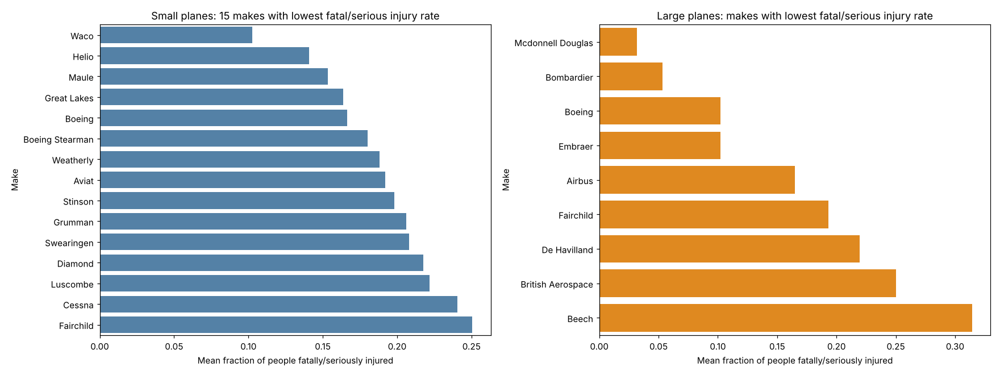
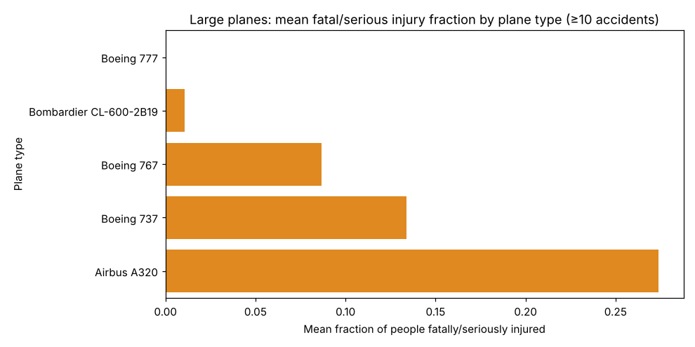
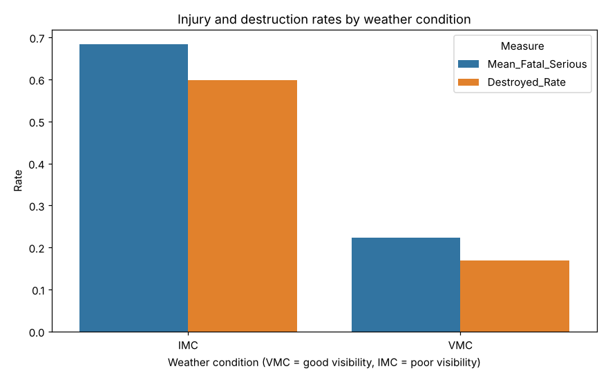
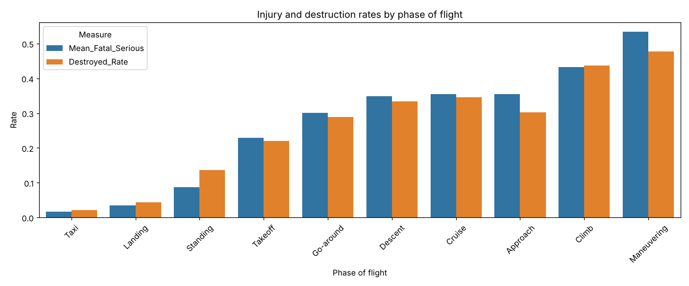

# Aviation Accident Analysis: Aircraft Safety Recommendations

## Business Problem

An airline/airplane insurer wants to know which aircraft (makes and models) have **low rates of destruction** and a **low likelihood of fatal or serious injuries** when an accident occurs, and which general conditions affect accident severity. The client wants:

- only **professionally built airplanes** that could still be in service (events from **1983 onwards**, assuming a 40-year maximum lifetime),
- **separate recommendations for small and large aircraft**,
- conclusions that are **statistically robust** (enough records per group).

## Data

- **Source:** NTSB aviation accident data, 1948–2023 (`data/AviationData.csv`), about 88,900 records and 31 columns.
- **After cleaning:** 57,791 accidents across 47 manufacturers and 4,094 plane types.

## Approach

### 1. Data cleaning (`Aviation_Accidents_Cleaning.ipynb`)
- **Standardized manufacturer names** (e.g. "CESSNA", "Cessna Aircraft Co" → "Cessna"; "Canadair" → "Bombardier").
- **Imputed missing aircraft categories:** about 56,000 records had no category. Makes that only ever appear as "Airplane" when the category is known (e.g. Cessna, Piper) were assumed to be airplanes, keeping most of the usable data.
- **Filtered** to airplanes, professional (non-amateur) builds and events from 1983 onwards.
- **Built two safety metrics:**
  - `Fatal.Serious.Fraction` = (fatal + serious injuries) / total people on board
  - `Destroyed` = 1 if the aircraft was destroyed, 0 otherwise
- **Robustness filters:** kept makes with at least 50 accidents; created a unique `Make.Model` identifier because model names are shared across makes.
- Cleaned placeholder values ("Unknown", "UNK", 0 engines) in engine type, weather, number of engines, purpose and phase of flight, and dropped columns with 20,000 or fewer non-null values.

### 2. Analysis (`Aviation_Accidents_Data_Analysis.ipynb`)
- Split aircraft into **small (< 20 people on board)** and **large (≥ 20)**.
- Compared mean injury fraction and destruction rate by **make** (≥ 50 accidents for small, ≥ 10 for large) and by **plane type** (≥ 10 accidents).
- Analyzed how **weather** and **phase of flight** affect accident severity.

## Key Findings

### Safest makes


- **Small aircraft:** **Maule** (≈0.15 injury fraction, ≈0.09 destroyed, 569 accidents), **Aviat**, **Waco** and **Diamond** (lowest destruction rate, ≈0.06) perform best on both measures.
- **Large aircraft:** **Bombardier** (≈0.05 injury, ≈0.06 destroyed), **Boeing** and **Embraer** (≈0.10 injury, ≈0.09–0.10 destroyed). Airbus performs noticeably worse (≈0.17 injury, ≈0.16 destroyed).

### Safest plane types


- **Large:** the **Boeing 777** (no fatal/serious injuries in 16 accidents) and the **Bombardier CL-600-2B19** (≈0.01 injury, never destroyed in 28 accidents) are safest; the **Boeing 737** is solid and the best documented (97 accidents).
- **Small:** **Beech 1900D** (43 accidents, ≈0.05 injury and destroyed), **Diamond DA 20 C1**, **Maule MX-7** series and **Piper PA-18** series.

### Factor 1: Weather


Accidents in **poor visibility (IMC)** are about **3 times more severe** than in good visibility (VMC): ≈0.68 vs ≈0.22 injury fraction, and ≈60% vs ≈17% of aircraft destroyed.

### Factor 2: Phase of flight


Ground and landing accidents are the most common but the least severe (Taxi ≈0.02, Landing ≈0.04 injury fraction). Accidents while **maneuvering** (≈0.53) and **climbing** (≈0.43) are far more likely to be fatal or destroy the aircraft.

## Recommendations

1. **Small aircraft:** prioritize **Maule, Aviat, Waco and Diamond**; specific types: Beech 1900D, Diamond DA 20, Maule MX-7 and Piper PA-18 series.
2. **Large aircraft:** prioritize **Bombardier, Boeing and Embraer**; specific types: **Boeing 777**, **Bombardier CL-600** and **Boeing 737**.
3. **Price weather risk:** operators flying frequently in instrument (poor-visibility) conditions carry much higher risk; instrument training and equipment should factor into premiums.
4. **Consider operation type:** low-altitude maneuvering operations (e.g. aerial application, aerobatics) have much more severe accidents than routine flights.

## Limitations and Next Steps

- The data contains **accidents only**, not total flights, so these are severity rates *given an accident*, not overall accident rates. Adding flight-hour or fleet-size data would allow true risk rates.
- Large-plane results rely on far fewer records (607 accidents) than small-plane results.
- Model sub-variants (e.g. Cessna 172, 172N, 172M) are counted separately; grouping them would increase sample sizes.

## Repository Structure

```
├── data/
│   └── AviationData.csv
├── images/                              # charts used in this README
├── Aviation_Accidents_Cleaning.ipynb    # data loading and cleaning
├── Aviation_Accidents_Data_Analysis.ipynb  # EDA, recommendations, factors
└── README.md
```
